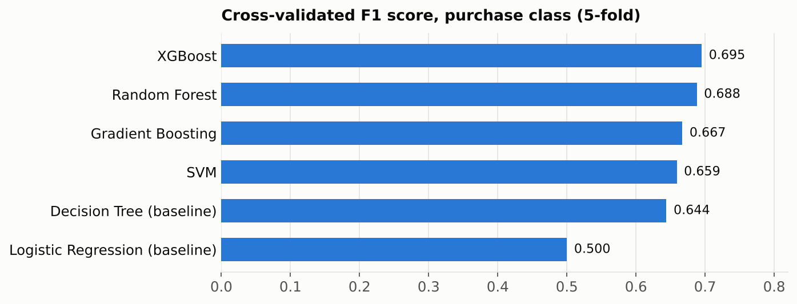
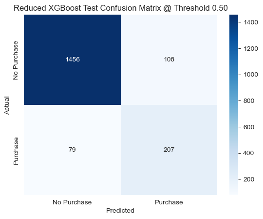
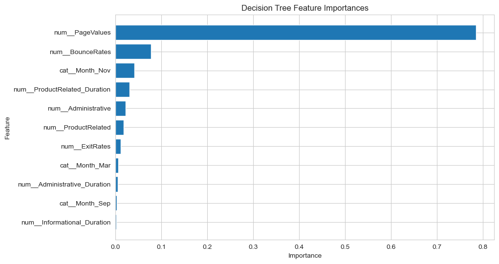

# Predicting Online Shopper Purchase Intent

**From a single browsing session, with no purchase history, can we predict whether a visitor will buy?**

Team project, M.S. in Data Analytics, University of Central Florida (Spring 2026).
**Team:** Chase Di Maria Breisinger · Fenny Bharucha · Fernando Ricaurte · Julian McKinley · Matheus Pereira Lucena

`Python` · `scikit-learn` · `XGBoost` · `pandas` · `matplotlib` · `seaborn`

---

## At a glance

| | |
|---|---|
| **Data** | 12,330 e-commerce sessions, 17 features (pages visited, time on page, bounce and exit rates, month, visitor type) |
| **Target** | `Revenue`: did the session end in a purchase? Only **15.5%** did |
| **Models** | 6: logistic regression and decision tree baselines, random forest, gradient boosting, XGBoost, SVM |
| **Final model** | XGBoost on 9 features. Test set: **F1 0.69, recall 0.72, ROC-AUC 0.93**, matching the full 12-feature model |

## Why it matters

Knowing which visitors are likely to buy lets a store target offers, personalize pages and spend advertising money where it converts. The difficulty is that buyers are rare: with 84.5% of sessions ending without a purchase, a model that predicts "no purchase" every time is 84.5% accurate and completely useless. This project therefore optimizes **F1 on the purchase class**, which balances finding buyers (recall) against being right when it predicts one (precision).

## Approach

1. **EDA.** Found strong class imbalance, heavily right-skewed and zero-inflated duration features, and correlated feature pairs (page counts with their durations, bounce with exit rates). `PageValues` showed the strongest relationship with purchasing.
2. **Preprocessing.** Dropped five undocumented coded features (browser, OS, region, traffic type, special day), one-hot encoded the categoricals and standardized the numeric features. All preprocessing sits **inside scikit-learn pipelines**, so it is re-fit on each training fold and never sees validation or test data.
3. **Splitting.** A stratified 85/15 train/test split. All tuning used **5-fold stratified cross-validation** on the training set, and the test set was used once, at the end.
4. **Tuning.** Grid search for every model, with class weighting (`class_weight`, `scale_pos_weight`) among the options.
5. **Threshold tuning.** Instead of the default 0.5 cutoff, each model's threshold was chosen to maximize F1 on **out-of-fold predictions** from the training set.
6. **Simplification.** Retrained the best models on a reduced 9-feature set chosen from decision tree importances.

## Results

### Model comparison (5-fold cross-validation, training set)

| Model | F1 | Precision | Recall | ROC-AUC |
|---|---|---|---|---|
| **XGBoost** | **0.695** | 0.666 | 0.727 | 0.933 |
| Random forest | 0.688 | 0.666 | 0.711 | 0.932 |
| Gradient boosting | 0.667 | **0.740** | 0.607 | **0.933** |
| SVM (RBF kernel) | 0.659 | 0.574 | **0.772** | 0.909 |
| Decision tree (baseline) | 0.644 | 0.708 | 0.592 | 0.918 |
| Logistic regression (baseline) | 0.500 | 0.741 | 0.379 | 0.896 |



The tree ensembles lead. Logistic regression is precise but misses most buyers (recall 0.38), a sign that purchase behavior is nonlinear. **The gap between XGBoost and a single shallow decision tree is small (0.695 vs 0.644)**, which suggests most of the signal follows a few simple threshold rules.

### Final model on the held-out test set (1,850 sessions)

The 9-feature XGBoost model matched the full model in cross-validation (F1 0.697 vs 0.695), so the simpler model was kept.

| Metric | Value |
|---|---|
| F1 (purchase class) | 0.689 |
| Precision | 0.657 |
| Recall | 0.724 |
| ROC-AUC | 0.932 |
| Accuracy | 0.899 |



The model found **207 of 286** buyers. When it flags a session as a likely purchase, it is right about two times in three.

### What drives a purchase



**`PageValues`**, the average value of the pages a visitor viewed before completing a transaction, dominates. Bounce rate, November (the holiday shopping season) and time spent on product pages follow. Engagement signals matter far more than technical details like browser or region.

## Limitations and next steps

- Sessions are predicted without user history; returning-customer data would likely add signal.
- Skewed features were standardized but not log-transformed, and SHAP values could explain individual predictions in more detail.
- The 9 reduced features were chosen using the full training set and then evaluated by cross-validation on that same set, which slightly favors the reduced model. The difference (F1 0.697 vs 0.695) is small enough to call the two models equivalent.

## Repository contents

| File | Description |
|---|---|
| [`online_shoppers_intention_code.ipynb`](online_shoppers_intention_code.ipynb) | Full analysis notebook with outputs: EDA, all models, threshold tuning, final evaluation |
| [`report/Shopper_Intention_Report.pdf`](report/Shopper_Intention_Report.pdf) | Written project report |
| [`data/online_shoppers_intention.csv`](data/online_shoppers_intention.csv) | Dataset (UCI, CC BY 4.0) |

## Reproduce

```bash
pip install -r requirements.txt
jupyter notebook online_shoppers_intention_code.ipynb
```

The XGBoost grid search is large (over 11,000 parameter combinations) and can take hours on a laptop. The saved outputs in the notebook show every result without re-running it.

## Data source and citation

Sakar, C. & Kastro, Y. (2018). *Online Shoppers Purchasing Intention Dataset*. UCI Machine Learning Repository. [https://doi.org/10.24432/C5F88Q](https://doi.org/10.24432/C5F88Q). Licensed under [CC BY 4.0](https://creativecommons.org/licenses/by/4.0/).
